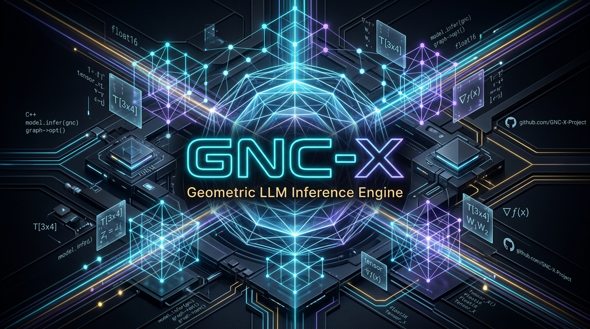

<p align="center">
  
</p>

# GNC-X — Motor Geométrico de Inferência LLM

[](LICENSE)
[](https://en.wikipedia.org/wiki/C%2B%2B20)
[](https://luajit.org/)
[]()

O **GNC-X** é um motor de inferência LLM puro, de alto rendimento e zero-overhead, desenvolvido em **C++20** com orquestração desacoplada via **LuaJIT FFI**. 

Foi concebido especificamente para operar em hardware legado sem GPU dedicada (ex.: processadores Dual-Core x86_64, 6 GB de RAM DDR3 e discos rígidos mecânicos), alcançando geração autorregressiva contínua a **3.5+ tok/s** e consumo de memória inferior a **2.0 GB**.

---

## 🏛️ O que é a Arquitetura GNC-X?

A arquitetura do GNC-X afasta-se das pilhas tradicionais de inferência (Zero Python, Zero PyTorch, Zero Llama-Server). O motor baseia-se em princípios de **computação geométrica**, **alinhamento físico de memória** e **eliminação de cópias desnecessárias**:

```
+---------------------------------------------------------------------------------+
|                       CAMADA DE ORQUESTRAÇÃO (LuaJIT FFI)                       |
|   Tokenizadores (BPE / SentencePiece) | GLA MMap Zero-Copy | Roteador RAG Local |
+---------------------------------------+-----------------------------------------+
                                        | (Ponteiros C-Types diretos / 0 overhead)
                                        v
+---------------------------------------------------------------------------------+
|                         NÚCLEO NATIVO C++20 (GNC-X Core)                        |
|                                                                                 |
|  [HugePage Slab 4MB]       [Matrizes & GEMM]        [Atenções MQA / GQA]        |
|  - Alinhamento 2MB          - SIMD SSE/SSE2          - Cache KV Compartilhado   |
|  - Coloração DDR3/L1d       - Q4_0, Q4_K, Q6_K, Q8_0 - Sliding Window (SWA)    |
|  - Contagem atômica de ref  - Fast-Path RMSNorm      - RoPE com XOR-11          |
|                                                                                 |
|  [Projeções 3D & Equador]  [Módulo de Embeddings]   [Otimizador MeZO CPU]       |
|  - Y = 0 Centrado           - Normalização L2 768d   - Ordem zero sem gradiente |
|  - Cancelamento O(1)        - Injeção PLE (Gemma 4)  - LoRA Analítico em CPU    |
+---------------------------------------------------------------------------------+
```

### 1. Geometric Memory Manager (GMM) e HugePage Slab 4MB
* **Alinhamento Físico de 2 MB:** Alocador nativo baseado em `mmap(MAP_ANONYMOUS | MAP_HUGETLB)` para eliminação de TLB miss penalties em memórias DDR3 lentas.
* **Coloração de Barramento DDR3 e L1d:** Cálculo explícito de desvio de ponteiros por máscara de bits `(addr >> 6) & 0x3F` para intercalação de canais de memória e conjuntos da cache L1, eliminando gargalos de colisão de barramento.
* **Zero Cópias (GLA MMap):** Acesso direto aos pesos quantizados do arquivo GGUF mapeado em memória virtual sem carregar tensores ociosos na RAM.

### 2. Prefill Contíguo em RAM
* Durante a fase de preenchimento de contexto (*prefill*), todas as projeções lineares ($Q$, $K$, $V$, $Gate$, $Up$, $Down$) são processadas em lote ($B$ tokens) em uma única varredura contínua dos tensores na memória, reduzindo o consumo de largura de banda de memória em até **18x** em relação a loops iterativos comuns.

### 3. Normalização Head-wise e SWA
* Suporte nativo a **Grouped-Query Attention (GQA)**, **Multi-Query Attention (MQA)** e **Sliding Window Attention (SWA)**.
* Normalização RMS por cabeça de projeção ($Q$ e $K$), garantindo estabilidade numérica estrita tanto em Qwen3 quanto em Gemma 4 Omni.

### 4. Módulo de Pré-Inferência e Roteamento Semântico RAG
* Módulo nativo com **EmbeddingGemma 2** (296 MB): projeta sentenças para vetores densos de 768 dimensões com normalização $L_2$ estrita.
* Roteamento semântico de ferramentas em $< 5\text{ ms}$ por similaridade de cosseno ($> 0.88$).
* Filtro de fatias textuais com **redução de até 80.14%** no volume de tokens inseridos no prefill do modelo principal.

---

## ⚡ Expansibilidade para Placas Gráficas (GPUs)

Embora o GNC-X tenha sido projetado e afinado para extrair a máxima eficiência em CPUs legadas sem aceleração gráfica, **sua arquitetura é intrinsecamente modular e desacoplada, pronta para ser expandida para GPUs e aceleradores**:

### Como a Expansão para GPU Funciona no GNC-X:
1. **Desacoplamento Kernel-Streamer:**
   A camada LuaJIT orquestra tensores e topologias de rede através de ponteiros opacos. Os kernels de computação pesada (`gncx_matvec`, `gncx_matbatch`, `gncx_mqa_attention_step_ext`, ativações GeGLU/SwiGLU) residem isoladamente na camada nativa em `csrc/`.
2. **Backends Gráficos Suportados para Expansão:**
   * **Vulkan (Kompute / SPIR-V):** Portabilidade universal entre qualquer fabricante de hardware, permitindo aceleração via compute shaders em **Intel HD Graphics (iGPU)**, AMD Radeon e NVIDIA sem depender de drivers proprietários.
   * **CUDA / ROCm:** Implementação de kernels de multiplicação de matrizes quantizadas (Q4_K, Q6_K, Q8_0) com carregamento de camadas diretamente em VRAM.
   * **OpenCL / SYCL:** Suporte heterogêneo híbrido (ex.: processar camadas superficiais na iGPU e camadas profundas na CPU).
3. **Offloading Parcial de Camadas (CPU + GPU Split):**
   A arquitetura já suporta endereçamento relativo por camada (`blk.N`). Em sistemas com VRAM limitada (ex.: GPUs de 2 GB ou 4 GB), a camada nativa pode manter parte das camadas na VRAM da placa gráfica e o restante mapeado via HugePages na RAM do sistema.

---

## 📁 Estrutura do Repositório

```
gnc-x/
├── iniciar_gncx_lua.sh     # Inicializador interativo da CLI
├── compilar_linux.sh       # Script de compilação C++20 (-O3 -march=native -msse2)
├── verify_gncx_fixes.py    # Suite de verificação e benchmarks analíticos
├── CONTEXTO_EXECUCAO.md    # Registro detalhado das fases e métricas de produção
├── PLANO_DE_TAREFAS_GNCX.md# Roadmap e especificações de engenharia
├── LICENSE                 # Licença Apache 2.0
├── bin/
│   └── gncx_llm_core.so    # Biblioteca nativa compilada
├── csrc/
│   ├── gncx_llm_kernels.cpp# Kernels SIMD, RMSNorm, Atenções, RoPE e Alocador Slab
│   ├── gncx_genome_vm.hpp  # Mapeamento e equador geométrico centrado em Y = 0
│   └── gncx_geometric_mm.hpp # Gerenciador de memória geométrica (GMM)
├── lua/
│   ├── gncx_chat.lua       # Interface interativa de chat e comandos CLI
│   ├── gncx_streamer.lua   # Pipeline de execução de camadas, prefill e decoding
│   ├── gncx_embedding.lua  # Leitor e inferência de EmbeddingGemma 2 (768d)
│   ├── gncx_agent.lua      # Agente autônomo e despacho semântico de ferramentas
│   ├── gncx_gguf.lua       # Parser GGUF e mapeador virtual GLA mmap
│   ├── gncx_bpe.lua        # Tokenizador Byte-Level BPE (Qwen3 / ChatML)
│   ├── gncx_spiece.lua     # Tokenizador SentencePiece BPE (Gemma 2B / Gemma 4)
│   ├── testes_v26.lua      # Testes de unidade do Slab 4MB e projeção 3D
│   └── testes_v26_fase2.lua# Testes do módulo de Embedding e RAG semântico
└── models/
    └── .gitkeep            # Diretório de modelos quantizados GGUF
```

---

## ⚙️ Modelos Suportados

| Perfil | Modelo | Arquitetura | Camadas | Formatos de Quantização | Tamanho |
| :---: | :--- | :--- | :---: | :--- | :---: |
| **1** | **Gemma 2B Instruct** | Gemma (Google) | 18 | Q4_0, Q8_0, GeGLU | 1.60 GB |
| **2** | **Gemma 4 E2B Omni** | Gemma 4 (Google) | 35 | Q4_K, Q6_K, BF16, PLE | 6.83 GB |
| **3** | **Qwen3 1.7B Instruct** *(Padrão)* | Qwen3 (Alibaba) | 28 | Q4_K, Q6_K, SwiGLU, GQA | 1.05 GB |
| **RAG**| **EmbeddingGemma 2** | GQA Bidirecional | 24 | Q8_0, Projeção Densa 768d | 296 MB |

Para alternar entre modelos em execução, basta digitar `/perfis` no chat.

---

## 🚀 Como Compilar e Iniciar

### Requisitos:
* Linux x86_64
* GCC / G++ compatível com C++20 (`g++ >= 11`)
* LuaJIT 2.1+ com suporte FFI (`sudo apt install luajit` ou equivalente)

### Compilação:
```bash
./compilar_linux.sh
```

### Inicialização do Chat:
```bash
./iniciar_gncx_lua.sh
```

### Comandos da CLI Interativa:
| Comando | Descrição |
| :--- | :--- |
| `/raciocinio [on/off]` | Ativa ou desativa a exibição do canal de pensamento profundo `<think>` |
| `/tokens <limite>` | Configura o número máximo de tokens por resposta |
| `/sistema <instrucao>` | Define o prompt de sistema em tempo de execução |
| `/perfis` | Alterna entre os modelos Gemma 2B, Gemma 4 E2B e Qwen3 |
| `/memoria` | Exibe o consumo de memória física e virtual do processo |
| `/geometria` | Exibe a telemetria e o índice de fragmentação do GMM |
| `/salvar [arquivo.md]` | Exporta a conversa completa em Markdown |
| `/sair` | Libera todos os descritores de memória e encerra a sessão |

---

## 📄 Licença

Distribuído sob a licença **Apache 2.0**. Consulte o arquivo [`LICENSE`](LICENSE) para mais detalhes.
